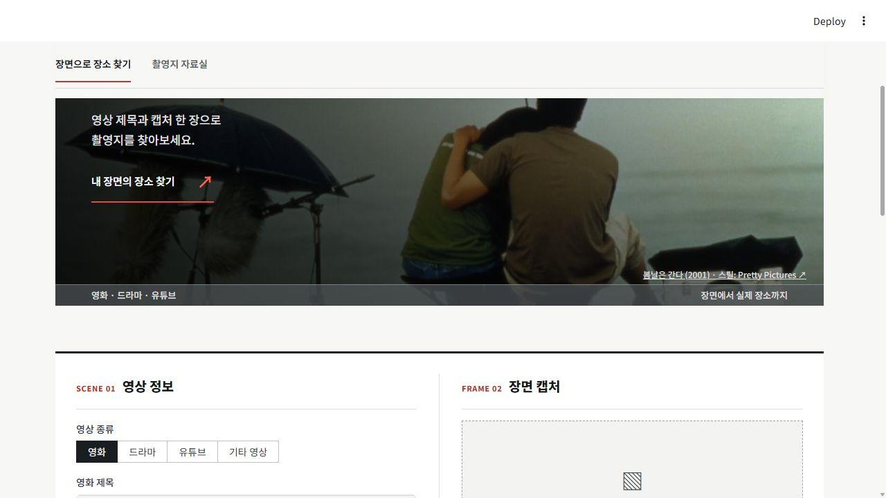
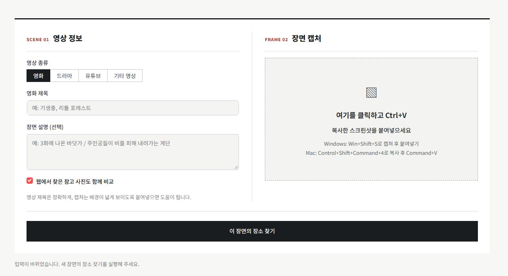
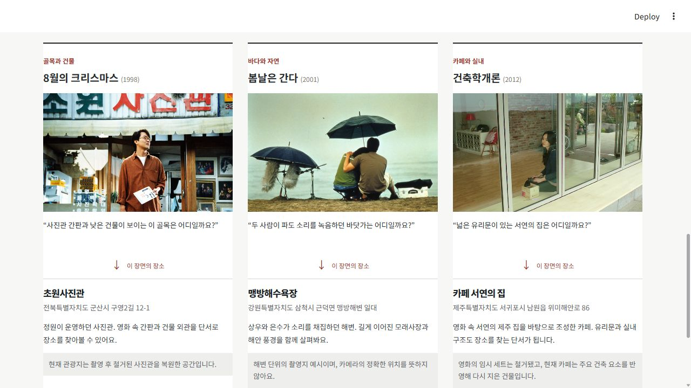
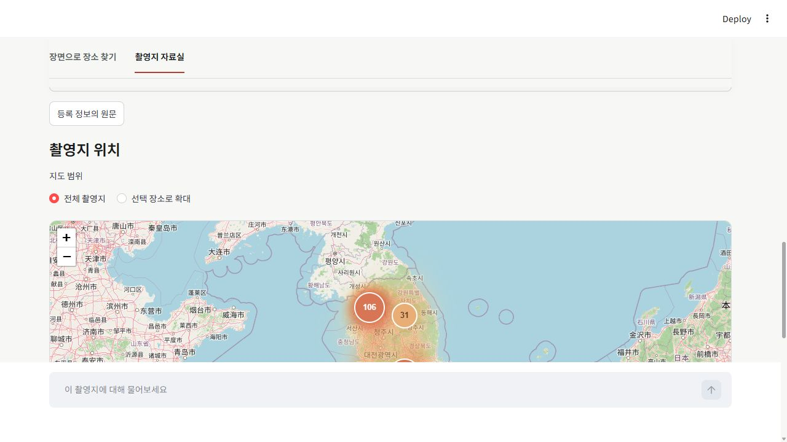
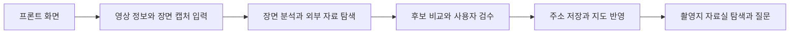

# 장면에서 여행으로

**프로젝트 주제: 영상 제목과 캡처로 촬영지를 찾아 검수하고 지도에 축적하는 RAG 서비스**

주제 설명과 발표용 소개는 `PROJECT_OVERVIEW.md`에 정리했습니다.

영상 제목과 붙여넣은 캡처로 촬영지 후보를 찾고, 촬영지 자료실에서 문서 근거로 질문하는 Streamlit 서비스입니다.

## 주요 기능 설명

### 1. 프론트 화면



**‘여기 어디지?’에서 시작하는 촬영지 탐색 서비스입니다.** 영상에서 마음에 든 배경을 발견하면 제목과 캡처로 장소를 찾아볼 수 있습니다. 상단 메뉴에서 장면 검색과 촬영지 자료실을 전환하며, 스크롤 중에도 메뉴를 이용할 수 있습니다.

### 2. 영상 정보 · 장면 캡처 입력



**영상 종류와 제목을 입력하고, 캡처를 붙여넣으면 검색 준비가 끝납니다.** 영화·드라마·유튜브·기타 영상 중 종류를 선택하고 오른쪽 영역에 `Ctrl+V`로 스크린샷을 붙여넣습니다. 회차나 장면 설명을 추가하면 탐색 단서를 보완할 수 있습니다. 참고 사진 비교 여부를 선택한 뒤 **이 장면의 장소 찾기**를 누릅니다.

### 3. 배경 탐색



**캡처 속 간판·건물·주변 풍경과 외부 촬영 자료를 함께 살펴 장소 후보를 찾습니다.** 검색한 후보에는 문서 근거와 원문 링크를 연결하고, 참고 사진과의 비교 및 추가 단서 입력으로 장소를 좁힐 수 있습니다. 화면은 골목·해변·실내 배경이 실제 장소와 어떻게 연결되는지 보여주는 고정 사용 예시이며, 실시간 AI 검색 결과가 아닙니다. 검색 후보만으로 촬영지가 확정되는 것은 아닙니다.

### 4. 지도 저장



**찾은 장소는 사용자 검수 후 주소로 저장합니다.** 결과의 ‘찾던 장소가 맞나요?’에서 장소명·주소·지역을 확인한 뒤 저장하면 자료실에 추가됩니다. 지도에 필요한 좌표는 자동 조회하며, 위치를 찾은 장소는 지도 핀으로 표시합니다. 자동 위치 조회가 실패해도 주소 저장은 유지되고 핀 표시는 보류됩니다. 위 이미지는 저장 이후 장소를 확인하는 지도 화면입니다.

### 5. 촬영지 자료실


**수집한 촬영지를 지도와 문서 근거로 다시 탐색하는 공간입니다.** 지도를 축소하면 장소 묶음과 개수를, 확대하면 개별 위치를 볼 수 있습니다. 핀을 선택하면 해당 장소의 설명과 질문 대상이 바뀝니다. 지역·작품명·장소명으로 목록을 좁히고, 연결된 문서를 바탕으로 장소에 관해 질문할 수 있습니다. 사용자 저장 장소는 정정·저장 취소·복원할 수 있습니다.

### 처리 흐름



이미지는 `docs/images/`에 보관하며 상대 경로로 연결했습니다. 지도 저장과 자료실 설명은 동일한 지도 화면을 사용합니다. 화면은 촬영 시점의 예시이며 수집 수와 화면 배치는 이후 변경될 수 있습니다.

## 현재 구현

- 영화·드라마·유튜브·기타 영상 제목 + Ctrl+V 캡처, 단서 분석·외부 검색·장소 후보와 근거·지도 표시.
- 촬영 장소 266곳 / 관련 영화 69편 / 설명 자료 연결 266곳 / 외부 자료 292건.
- 설명 자료는 공공 CSV의 원문 장소설명 269건과 별도 조사 요약 23건입니다. 문서를 새로 창작하거나 촬영 사실 검증 완료로 승격하지 않습니다.
- Chroma `location_meta` 266건, `location_documents` 292개 청크를 실제 생성했습니다.
- 로컬 다국어 MiniLM 의미 임베딩. GMS 임베딩 호출 없이 동작합니다.
- 유사도/MMR 검색 전환 및 설정별 실제 근거 비교 보고서.
- LangGraph `retrieve → generate`, 선택 장소 메타데이터 상시 포함, 장소별 외부 문서 검색·중복 제거·Top-k.
- 자료실의 자연어 조건 탐색: 의미 검색 후 LLM으로 조건 충족 항목 선별, 실제 문구 검증, 선택한 장소 채팅으로 이동.
- 질문별 외부 문서 수집: 검색어 추출 프롬프트 → 후보 선별 프롬프트 → 원문 수집·색인. 기존 장소 자체 문서는 선별과 관계없이 색인합니다.
- 근거 번호와 사용한 문서 제목·출처 유형·원문 링크 표시, 장소별 대화 격리.
- 진행 상태·키 누락·색인 없음·오류 안내, 비용 한도·캐시.

## 실행

Python 3.10 이상, 권장 3.12. 프로젝트 폴더에서 실행합니다.

```powershell
python -m venv .venv
.\.venv\Scripts\python.exe -m pip install -r requirements.txt
Copy-Item .env.example .env
.\.venv\Scripts\python.exe scripts/import_research.py
.\.venv\Scripts\python.exe scripts/build_index.py
.\.venv\Scripts\python.exe -m streamlit run app.py
```

`.env`에 `GMS_KEY`, 실제 계정의 텍스트 모델 `GMS_MODEL`, 이미지 지원 모델 `GMS_VISION_MODEL`을 설정합니다. 위키 수집을 쓰려면 `WIKI_CONTACT`에 영문 연락처를 입력합니다. 키는 소스에 넣거나 공유하지 않습니다.

최초 색인은 다국어 임베딩 모델을 인터넷에서 다운로드합니다. 이후 `.models`에 저장한 모델을 재사용합니다. 자료실의 `기본 자료 색인 / 갱신`으로도 색인할 수 있습니다. `.vectors`가 없는 다른 PC에서는 재색인해야 합니다.

키가 없으면 자료·지도·입력·색인을 확인할 수 있습니다. 실제 모델이 필요한 채팅·조건 선별·검색어 생성·캡처 판단은 키 연결이 필요합니다.

## 검색 결과 검수 후 추가 저장

검색 결과마다 **찾던 장소가 맞나요?**가 표시됩니다. `맞아요`를 선택하고 장소명·주소·지역을 검수한 뒤 저장 버튼을 눌러야 영구 저장됩니다. `검토 중` 또는 `다른 장소예요`는 저장하지 않습니다.

장소명·주소·지역을 확인하면 좌표 입력 없이 저장할 수 있습니다. 주소를 먼저 영구 저장한 뒤 동일 주소의 기존 위치 또는 Photon/OpenStreetMap 검색으로 지도 좌표를 자동 조회합니다. 자동 조회 실패가 주소 저장을 막지 않으며, 위치를 찾지 못한 장소는 지도 핀 표시가 보류됩니다. 자동 변환 위치는 현장 정밀도나 촬영 사실 검증을 뜻하지 않습니다. 위치 조회에는 GMS 토큰을 쓰지 않습니다.

저장은 `data/confirmed_locations.sqlite3`에 보관하며 기본 JSON 재생성과 분리됩니다. 같은 장소명·주소는 중복 추가하지 않고 작품·근거를 병합합니다. 사용자 확인 표시는 공식 촬영 사실 검증과 구분됩니다. 저장 후 로컬 벡터 색인을 갱신하고, 자료실·지도와 이후 캡처 검색에 사용합니다. 색인이 실패하면 DB 저장은 유지하고 자료실에서 재색인 안내를 표시합니다.

기존 기본 자료에 같은 장소가 있으면 기존 ID를 사용합니다. 기본 자료에 이미 있는 좌표는 조용히 교체하지 않습니다. 새로 받은 좌표는 기존 좌표가 비어 있을 때 반영합니다. 추가된 모든 사용자 데이터는 `confirmed_locations.sqlite3`를 별도로 백업해야 하며, 캐시 DB와 다릅니다. 외부 공개·제출 전 저장된 출처·주소·이용 조건을 검토하세요.

검증: `python check_confirmed.py`는 임시 DB에서 미승인 무저장, 좌표 유효성, 위치 검색 실패 시 주소 저장, 저장 지속성, 중복 병합, 검수 UI, 자료실 이동을 검증합니다.

## 호출별 GMS 비용

| 작업 | GMS 사용 |
|---|---|
| 데이터 재생성·로컬 임베딩·색인·의미 검색 | 없음 |
| 기존 설명 자료 채팅 | 보통 1회 |
| 자연어 조건 탐색 | 후보 선별 1회 |
| 질문으로 외부 자료 추가 | 새 수집 보통 2회, 완료 수집 재사용 시 없음 |
| 캡처 장소 검색 | 새 검색 보통 2회 |

기본 하루 최대 30회 시도, 자동 모델 재시도 없음. 자료실 출력 600토큰, 청크 700자/겹침 100자, 전체 Top-k 3(메타데이터 1건 포함), 근거 본문 2,600자, 이력 최근 최대 2턴·1,000자입니다. `.env.example`에서 변경할 수 있습니다. 호출 실패도 일일 시도에 포함합니다.

웹/모델 단기 캐시는 `.cache`, 완료된 자료 수집과 검색어·원문은 `data/collected`, 벡터는 `.vectors`에 보관합니다. 수집 완료 상태는 TTL 없이 재사용하므로 최신 정보가 자동 반영되는 것은 아닙니다. 캐시는 계정 전체 금액 한도가 아닙니다.

## 설계·검증·출처

- `RAG_DESIGN.md`: 컬렉션·프롬프트·검색·제약과 출처 이용 조건.
- `REQUIREMENTS_CHECKLIST.md`: 최초 진단 기록과 현재 보완 상태 안내.
- `IMPLEMENTATION_STATUS.md`: 보완 후 요구사항별 결과 및 미확인 사항.
- `data/research/manifest.json`: 데이터 출처·이용 안내·건수·해시.
- `data/research/README.md`: 원본·촬영 관계 검증 범위.

```powershell
python check_rag.py
python check_scene.py
python check_app.py
python check_savings.py
python check_grounding.py
python check_confirmed.py
python scripts/verify_project.py
python scripts/run_checks.py
python scripts/package_project.py
python -m pip check
```

`check_rag.py`는 실제 로컬 모델·Chroma·그래프 연결을 검증하고, GMS와 외부 수집은 모의 응답을 사용합니다. 다른 테스트도 실제 GMS를 호출하지 않습니다. Windows Chroma가 임시 mmap 파일을 유지하면 테스트 임시 폴더 정리는 프로세스 종료 후 필요할 수 있습니다.

## 범위와 남은 확인

자료실 항목은 **장소**입니다. 266곳 전체가 촬영 사실 재검증 완료인 것은 아니며 별도 촬영 관계를 확인한 장소는 23곳입니다. 공공 원문은 짧거나 오래됐을 수 있고, 영업·출입·정밀 좌표를 보증하지 않습니다. 문서가 있어도 모든 질문에 답할 수 있는 것은 아닙니다.

실제 GMS 연결·지원 모델·답변 품질·전체 응답 시간은 아직 검증하지 않았습니다. 실제 실행 증거와 상호 점검은 별도 필요합니다. MMR은 구현·로컬 비교를 완료했고 독립 프론트/서버와 실제 RAG 전후 답변 품질 비교는 미구현/미실행입니다.

원본 `C:/Users/SSAFY/Desktop/streamlit_lab`의 소스는 변경하지 않았습니다. 실행용 venv에는 필수 라이브러리를 추가했습니다. 제출물에서 `.env`, `.models`, `.vectors`, `.cache`, 가상환경, 재배포 조건을 확인하지 않은 수집 원문은 제외하고 재생성 절차를 제공하세요.


## 독립 HTML/JS 화면과 API 서버

프로젝트 폴더에서 `python -m uvicorn api:app --host 127.0.0.1 --port 8000`을 실행하고 http://127.0.0.1:8000 으로 접속한다. 기존 Streamlit 화면은 `streamlit run app.py`로 유지된다. 두 화면은 동일한 카탈로그·확인 DB·벡터 저장소를 사용한다. `.env` 변경 후 서버를 재시작한다. 키는 브라우저에 전달하지 않는다.

독립 화면도 Ctrl+V 캡처, 매체 선택, 검수 후 DB 저장, 지도 핀과 상세 연결, 장소별 대화, MMR, 조건 탐색, 문서 수집을 제공한다. GMS 키가 없으면 자료실·지도·로컬 색인을 사용할 수 있다. 로컬 개발용이며 인터넷 공개용 인증·사용자별 저장 격리는 범위에 포함되지 않는다.

검사: `python scripts/run_checks.py`, `python scripts/verify_project.py`, `python scripts/compare_rag.py`. 마지막 명령의 기본 실행은 토큰을 쓰지 않는다. `--run-gms`는 실제 호출이므로 이번 검수에서는 실행하지 않았다.

최종 판정은 FINAL_CHECKLIST.md, 출처·권리 검토는 LICENSE_REVIEW.md, 교육생 상호 검수용 빈 양식은 PEER_REVIEW.md에 있다.


### 촬영지 검색 보완 (2026-10-22)

검색 결과 최대 6개 원문을 확인하고, 검색 요약과 촬영 관련 본문 문장을 우선 보존한다. 기사에서 촬영지로 명시한 후보와 캡처의 시각 일치 여부를 구분하여 표시한다. 시각 비교 불충분만으로 기사 속 촬영지를 숨기지 않도록 판단 지침을 변경했다. 근거 없는 장소명·인용·주소 검증과 사용자 검수 후 저장은 유지한다. 추가 LLM 단계는 없으며 검색 캐시 버전을 변경했다. 실제 GMS 장면 정확도는 별도 실행 확인이 필요하다.


### 2026-10-22 단계별 개선

장면별 회차·설명 저장, 사용자 기록 정정/취소/복원, 공식 본문 검토 대기함, 키워드+의미 검색, 기존 캡처에 단서 추가 기능을 제공한다. 사용법·평가 경계와 규칙 보존 내역은 IMPROVEMENTS_20261022.md 참조. 새 수집 본문은 별도 로컬 DB에 보관해 검토 ZIP에 포함하지 않는다.

`python scripts/enrich_official.py 5`로 기존 공식 출처 최대 5개 본문을 대기함에 수집할 수 있다. `python scripts/benchmark_retrieval.py`는 모델 생성 없이 23개 공식 근거 검색을 비교한다. 실제 답변 비교와 혼동하지 않는다.


### 장면과 참고사진 나란히 비교

장면 검색 결과의 후보별 비교 영역에서 내 캡처와 참고사진을 나란히 표시하고 사진 선택·확대를 제공한다. 독립 웹 화면은 좁은 화면에서 세로로 배치한다. 모델이 실제 사용한 참고사진과 단순 검색 참고자료를 구분한다. 비교 UI 자체는 GMS를 호출하지 않는다. 장소 정정·저장 취소·복원은 자료실의 사용자 저장 장소에서, 단서 추가는 장면 검색 결과에서 사용할 수 있다.

검수 화면 photo_comparison_preview.png와 photo_comparison_web_preview.png는 임시 예시 이미지로 확인한 UI이며 실제 촬영지 검색·정답률 증거가 아니다.


### 슬레이트·필름 디자인과 문구 기준

영상 정보와 캡처를 하나의 슬레이트 격자로 묶고, 붙여넣은 사진을 사진 칸 안에 미리 표시한다. 사용 예시는 아날로그 필름의 프레임과 구멍 모양으로 구성했다. 넓은 화면에서는 입력 2칸·예시 3칸, 좁은 화면에서는 세로로 배치한다. 기존 붙여넣기·검색·검수 저장 동작은 유지했다.

사용자가 제공한 Scope_배포자료.md 중 관련 원문을 확인해 DESIGN.md에 프로젝트 기준을 정리했다. AGENTS.md는 이후 UI·문구 작업 시 이 기준을 읽도록 안내한다. 장식용 영문 소제목과 중복 문구를 줄이고 출처와 불확실성은 보존한다. 검수 기록은 data/validation/design_verification.json과 slate_desktop.png, film_desktop.png, film_mobile.png다. 새 모듈을 반영하려면 실행 중인 앱을 재시작한다.
