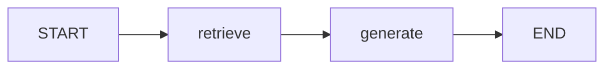

# RAG 파이프라인 설계

## 항목과 데이터

항목은 영화가 아니라 촬영 장소다. 이름·지역·주소·관련 작품·장소 유형·원본 장면 설명·검증 상태를 `metadata_text()`로 묶는다. 현재 266항목이며 작품은 69편이다. 항목 설명 자료는 한국문화정보원 CSV 원문의 `장소설명` 269건과 별도 공식 안내 조사 요약 23건, 합계 292건이다. 모든 장소에 하나 이상의 문서가 연결된다. 원문 필드를 문서로 구조화한 것이며 별도 기관의 독립 검증 문서가 266개 생긴 것은 아니다.

## 컬렉션

| 컬렉션 | 단위 | ID | 메타데이터 |
|---|---|---|---|
| location_meta | 장소당 1건 | 장소 ID | item_id, title, url, source_type, hash |
| location_documents | 외부 문서 청크 | 장소ID:문서ID:순번 | item_id, document_id, title, url, source_type, collected_at, license, chunk, hash |

로컬 Chroma PersistentClient를 사용한다. 같은 문서가 여러 장소에 연결돼도 장소 ID가 다르므로 덮어쓰지 않는다. 동일 ID·본문 해시는 다시 임베딩하지 않고, 변경 시 upsert한다. 문서가 짧아지면 해당 문서의 초과 청크만 삭제한다. 기본 자료에서 사라진 장소·문서의 전역 자동 삭제는 하지 않는다.

임베딩은 FastEmbed의 `sentence-transformers/paraphrase-multilingual-MiniLM-L12-v2` ONNX 모델이다. 384차원 의미 벡터를 CPU에서 계산하며 GMS 호출이 없다. 한국어를 지원하고 전용 GPU 없이 동작하는 모델을 선택했다. 모델을 바꾸면 기존 컬렉션과 섞지 말고 새 저장 경로에서 전체 색인해야 한다.

## 준비·수집·색인

1. `scripts/import_research.py`: 보존한 공공 CSV와 조사 요약을 합쳐 장소 목록과 문서를 재생성한다. 보류한 4개 관계는 포함하지 않는다.
2. `scripts/build_index.py`: 메타데이터 텍스트와 설명 문서를 각각 임베딩해 두 컬렉션에 넣는다.
3. 질문별 추가 조사: 항목 자체 기존 설명 문서를 우선 색인한 다음 프롬프트1로 검색어를 만들고, 장소명 자체 검색어를 코드로 추가해 누락을 막는다.
4. 공개 검색 결과 최대 8개를 프롬프트2에 전달해 최대 3개 문서를 선택한다. 이때 본문을 아직 받지 않는다.
5. 선택 문서의 HTML 본문을 수집하고 출처·유형·수집일과 함께 청킹·색인한다. 본문 확보 실패는 색인하지 않는다.
6. 완료 결과는 `data/collected`에 영구 기록한다. 같은 완료 질문, 검색어, 원문 URL은 다시 수집하지 않는다. 실패한 수집은 완료로 고정하지 않는다.

자체 설명 문서는 현재 제공된 공공 원문과 공식 요약을 뜻한다. 임의의 새 웹 검색 결과를 장소 자체 설명 문서라고 추정해 강제 채택하지 않는다. 공개 API가 제한된 경우에도 미리 확보한 공공 문서 묶음으로 기본 RAG를 사용할 수 있다.

## 프롬프트

| 역할 | 입력 | 출력·제약 |
|---|---|---|
| 1 검색어 추출 | 장소 텍스트·사용자 질문 | `queries` JSON 목록 최대 2개. 촬영지 자료 전문가 역할 |
| 2 후보 문서 선별 | 장소·질문·후보 제목/요약/URL | 관련 문서 `ids` JSON 목록 최대 3개. 범위 밖 ID 제거 |
| 3 답변 생성 | 선택 장소, 번호·유형을 붙인 검색 근거, 제한된 대화 이력 | 현재 문서만 근거로 한국어 5문장 이내, 주요 주장 `[근거 N]`, 근거 없으면 확인 불가 |

추가로 자연어 탐색은 후보 메타데이터에서 조건을 모두 확인할 수 있는 장소만 LLM으로 선별한다. 없는 조건을 추정하지 않도록 하고, 반환 항목 ID와 인용문이 실제 후보에 존재하는지 코드로 확인한다. 조건 전체 충족 여부 자체는 모델의 판단이므로 실제 평가 질문으로 추가 검증해야 한다.

캡처 분석은 별도의 특화 흐름으로 유지한다. 영상명·이미지 단서 → 웹 검색 → 참고 이미지와 자료 비교 → 근거가 있는 장소 후보를 제시하며, 자료실 RAG를 대체했다고 간주하지 않는다.

## LangGraph

`retrieve`: 선택 장소 메타데이터를 ID로 항상 포함하고, 질문 의미 벡터로 외부 문서 컬렉션을 `item_id` 필터 검색한다. 두 결과를 합쳐 본문+URL 중복을 제거한다. `generate`: 병합된 현재 근거로만 모델 답변을 요청한다. 그래프 상태는 item, question, history, sources, result다.

검색은 cosine, Top-k 기본 3(항목 1+외부 최대 2)이다. 짧은 질문에 필요한 사실만 전달하고 비용을 줄이려는 초기값이다. 청크는 700자, 겹침 100자이며 본문 예산은 2,600자다. 큰 청크는 주변 문맥이 늘지만 관계 없는 내용과 토큰이 증가한다. 작은 청크는 검색 구절이 세밀해지지만 문맥이 끊길 수 있다. 실제 테스트에서 1,200자 합성 문서는 300/50 설정에서 5청크, 700/100에서 2청크였다. 이는 구조 검증이며 실제 질문 정확도의 우열 결과가 아니다.

현재 선택 항목 메타데이터는 항목 1청크 요구에 따라 분할하지 않는다. 매우 긴 신규 항목을 추가할 때는 모델 토큰 길이 제한을 점검해야 한다. 외부 본문도 문자 청크와 모델 토큰 길이가 같지 않으므로 긴 외국어/특수문자 문서는 별도 평가가 필요하다.

## 근거·UI

후속 보완: 자료실에서 유사도/MMR을 선택할 수 있다. MMR은 외부 문서 후보를 최대 `max(4*k,20)`개 범위에서 확보하고 cosine 관련성 0.5와 기존 선택과의 중복도 0.5를 결합해 고른다. 항목 메타데이터는 두 방식 모두 항상 포함한다. 실제 결과와 Top-k 비교는 `data/validation/retrieval_comparison.md`에 기록했다. 짧고 적은 문서에서는 결과가 같을 수 있다.

생성 단계에서는 실제 모델 입력으로 보낸 본문 길이와 근거 목록을 맞추고 그 목록으로 화면을 구성한다. 범위 밖 근거 번호나 인용 없는 단정 답변은 내용을 그대로 노출하지 않고 확인 불가 안내로 대체하며 재사용 캐시에 저장하지 않는다. 이는 인용 연결 검증이며 실제 문장과 근거의 의미적 일치·정확성 평가를 대체하지 않는다.

자료실 답변의 인용 번호를 파싱해 실제 사용 문서만 제목·유형·원문 링크로 표시한다. 인용이 없으면 별도 안내한다. 근거가 공공데이터라면 재검증 전 자료라는 유형을 유지한다. 대화는 장소 ID별 세션에 분리한다. 자연어 탐색 결과의 버튼은 해당 장소 선택을 바꿔 채팅으로 연결한다. 키와 색인 누락, 진행 상태, 수집 실패는 일반 안내로 표시하고 프롬프트·키·추적 정보는 출력하지 않는다.

## 이용 조건과 운영 제약

- 공공 CSV: [한국문화정보원 공공데이터포털](https://www.data.go.kr/data/15111405/fileData.do)의 무료·이용허락범위 제한 없음 표기를 기록했다. 각 원문 행 번호와 날짜를 보존한다. 다른 웹 자료·사진에 적용되는 허가가 아니다.
- 공식 안내 조사 요약: 권리자의 본문 전문이 아니라 사실 요약이다. 개별 출처 URL과 기관명을 제공한다. 원문 재배포 권한을 주장하지 않는다.
- 위키백과: [이용약관](https://foundation.wikimedia.org/wiki/Policy:Terms_of_Use)과 문서별 표시 라이선스 적용. 문서 URL과 유형을 보존하고 API 전에 영문 WIKI_CONTACT를 요구한다. 기본 자료 준비에 위키 호출은 필요하지 않다.
- 새 웹 본문: 로컬 조사 캐시로 보관하며 기본 제출물/공개 저장소에서 제외한다. 출처별 재사용·수집 허용 조건의 개별 검토는 남아 있다. `license`의 미확인 표기는 허가 증거가 아니다.
- 예시 영화 이미지: 원문 페이지와 제공처를 표시하는 외부 링크 이미지다. 배포용 이미지 사용 허락 확인은 남아 있으므로 서비스 공개 전 별도 확인이 필요하다.
- 고운돋움: [Google Fonts의 Gowun Dodum](https://github.com/google/fonts/tree/main/ofl/gowundodum), SIL Open Font License 1.1. 폰트 원본을 배포할 때 해당 라이선스를 포함해야 한다.
- 로컬 임베딩 모델: [모델 카드](https://huggingface.co/sentence-transformers/paraphrase-multilingual-MiniLM-L12-v2), Apache-2.0. 모델 파일은 `.models`에 캐시하고 소스 제출에 포함하지 않는다.

외부 요청은 프로세스 내 같은 호스트 기준 최소 1초 간격, 위키 429 제한 대기, GMS 자동 재시도 없음으로 구성했다. 외부 사이트마다 추가 정책이 있을 수 있어 이것만으로 모든 출처 정책 준수를 보증하지 않는다.

## 검증의 경계

실제 로컬 임베딩·Chroma 쓰기/검색·동일 색인 재실행·장소 필터·Top-k·그래프 연결을 실행했다. GMS 응답과 추가 조사 네트워크는 모의 검증했다. 실제 키를 넣은 검색어 추출·문서 선별·조건 탐색·답변·캡처 정확도와 전체 응답 시간, 상호 점검은 미확인이다. 이 문서로 해당 결과를 통과 처리하지 않는다.
